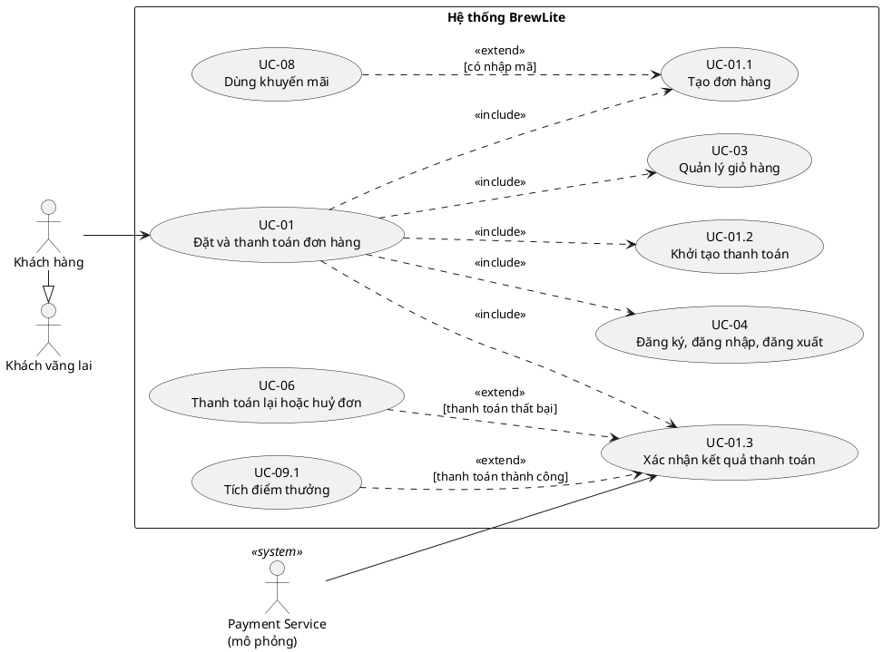

# Đặc tả use case trọng tâm: UC-01 Đặt và thanh toán đơn hàng

Use case **Đặt và thanh toán đơn hàng** được chọn vì đây là luồng tạo doanh thu duy nhất của hệ thống; các use case theo dõi đơn, thanh toán lại, huỷ đơn và xử lý đơn đều phụ thuộc vào đơn do use case này tạo ra.

## 1. Sơ đồ use case

## 2. Tác nhân, trigger, tiền điều kiện và hậu điều kiện

| Mục | Nội dung |
|---|---|
| Tác nhân chính | Khách hàng |
| Tác nhân thứ cấp | Cổng thanh toán (mô phỏng): trả kết quả thanh toán thành công hoặc thất bại |
| Trigger | Khách hàng nhấn "Đặt hàng" tại màn hình thanh toán |
| Tiền điều kiện | 1. Khách đã đăng nhập, access token còn hạn. 2. Giỏ hàng có ít nhất 1 món; mỗi món có sản phẩm, size, topping và số lượng nguyên ≥ 1. 3. Sản phẩm đang bán, size và topping hợp lệ |
| Hậu điều kiện – thành công | Đơn ở trạng thái `PAID`; tồn kho đã trừ đúng một lần; khách thấy màn hình xác nhận có mã đơn; giỏ hàng được xoá |
| Hậu điều kiện – thanh toán thất bại | Đơn ở trạng thái `PAYMENT_FAILED`; giỏ hàng được giữ; không cộng điểm |
| Hậu điều kiện – lỗi khi tạo đơn | Không có đơn mới; tồn kho không đổi |

## 3. Luồng sự kiện

### 3.1 Luồng chính (thanh toán thành công)

| Bước | Tác nhân | Hành động |
|---|---|---|
| 1 | Khách hàng | Chọn phương thức thanh toán (Ví hoặc Thẻ) và nhấn "Đặt hàng" |
| 2 | Hệ thống | Kiểm tra đăng nhập và dữ liệu đầu vào |
| 3 | Hệ thống | Tính giá từng dòng và tổng tiền ở server (giá gốc + phụ thu size + topping) |
| 4 | Hệ thống | Trừ tồn kho và tạo đơn `PENDING` trong cùng một thao tác, trả mã đơn |
| 5 | Hệ thống | Tạo giao dịch thanh toán `PENDING` gắn `Idempotency-Key`, trả thông tin thanh toán mô phỏng |
| 6 | Payment Service | Trả kết quả thanh toán thành công |
| 7 | Hệ thống | Chuyển giao dịch và đơn sang `PAID`, cộng điểm thưởng và ghi nhật ký điểm trong cùng thao tác |
| 8 | Hệ thống | Hiển thị màn hình xác nhận kèm mã đơn và xoá giỏ hàng |

### 3.2 Luồng thay thế

| Mã | Điều kiện | Diễn biến |
|---|---|---|
| ALT-1 | Khách nhập mã khuyến mãi | Server kiểm tra mã và tính mức giảm; tổng tiền = tạm tính − mức giảm; quay lại bước 4 |
| ALT-2 | Khách chưa đăng nhập ở bước 1 | Giao diện yêu cầu đăng nhập; sau khi đăng nhập quay lại bước 1, giỏ hàng giữ nguyên |
| ALT-3 | Thanh toán thất bại ở bước 6 | Giao dịch `FAILED`, đơn `PAYMENT_FAILED`; giao diện báo lỗi và giữ giỏ hàng; khách chọn thanh toán lại hoặc huỷ đơn |
| ALT-4 | Khách thanh toán lại | Đơn từ `PAYMENT_FAILED` về `PENDING`; quay lại bước 5 với `Idempotency-Key` mới |
| ALT-5 | Khách huỷ đơn | Đơn chuyển `CANCELLED`; tồn kho của các dòng hàng được hoàn lại đúng một lần |
| ALT-6 | Gửi lại yêu cầu thanh toán cùng `Idempotency-Key` cho cùng đơn | Trả kết quả đã có, không tạo giao dịch thứ hai |

### 3.3 Luồng ngoại lệ

| Mã | Tình huống | Phản hồi |
|---|---|---|
| EXC-1 | Không có Bearer token, token hết hạn hoặc không hợp lệ | 401 |
| EXC-2 | Danh sách món rỗng hoặc số lượng < 1 | 400, không tạo đơn |
| EXC-3 | Sản phẩm không tồn tại hoặc ngừng bán | 404 |
| EXC-4 | Size hoặc topping không hợp lệ | 400 |
| EXC-5 | Không đủ tồn kho | 409, không tạo đơn, tồn kho không đổi |
| EXC-6 | Mã khuyến mãi không hợp lệ (không tồn tại, hết hạn, đã dùng, chưa đạt mức tối thiểu) | 404 hoặc 400, không tạo đơn |
| EXC-7 | Thiếu `Idempotency-Key` khi khởi tạo thanh toán | 400 |
| EXC-8 | Đơn không tồn tại | 404 |
| EXC-9 | Đơn đã thanh toán hoặc không thể thanh toán | 409 |
| EXC-10 | Người không phải chủ đơn thanh toán | Bị từ chối |
| EXC-11 | `Idempotency-Key` đã gắn với đơn khác | 409 |
| EXC-12 | Xác nhận thanh toán thiếu `success` hoặc sai kiểu | 400 |
| EXC-13 | Gọi xác nhận lặp lại | Không xử lý lần hai: không cộng điểm, không trừ kho thêm |
| EXC-14 | Lỗi giữa chừng khi xác nhận thành công | Hoàn tác toàn bộ: đơn, tồn kho, điểm |
| EXC-15 | Nhiều yêu cầu đặt cùng lúc | Tổng số bán ra không vượt tồn kho; tồn kho không âm |

## 4. Liên kết với mã yêu cầu

| Thành phần | Mã yêu cầu |
|---|---|
| UC-01.1 Tạo đơn hàng | FR-12, FR-13 |
| UC-01.2 Khởi tạo thanh toán | FR-15, FR-17 |
| UC-01.3 Xác nhận kết quả thanh toán | FR-16, FR-17 |
| UC-03 Quản lý giỏ hàng (include) | FR-05, FR-06, FR-07 |
| UC-04 Đăng nhập (include) | FR-08, FR-09, FR-11 |
| UC-08 Dùng khuyến mãi (extend) | FR-14, FR-25 |
| UC-09.1 Tích điểm thưởng (extend) | FR-27 |
| UC-06 Thanh toán lại hoặc huỷ đơn (extend) | FR-18, FR-23 |
| Hiển thị xác nhận và trạng thái đơn | FR-20, FR-21 |
| Phi chức năng liên quan | NFR-02, NFR-03, NFR-08 |

## 5. Phạm vi: hệ thống làm gì và không làm gì

**Hệ thống làm:**

- Tạo đơn từ giỏ hàng, tính giá ở server, trừ tồn kho cùng thao tác với tạo đơn.
- Áp mã khuyến mãi tuỳ chọn.
- Khởi tạo và xác nhận thanh toán mô phỏng, có idempotency.
- Cộng điểm thưởng tự động khi thanh toán thành công.
- Cho khách thanh toán lại hoặc huỷ đơn khi thanh toán thất bại.

**Hệ thống không làm (Won't ở bản này):**

- Thanh toán thật qua cổng ngoài như Momo, VNPay, Stripe (FR-29).
- Giao diện nhân viên quầy (FR-30).
- Trang quản trị menu, giá, tồn kho (FR-31).
- Thông báo khi đơn sẵn sàng (FR-32).
- Hoàn tiền thật khi huỷ đơn đã thanh toán.

## 6. Tiêu chí chấp nhận

| Mã | Yêu cầu | Tiêu chí chấp nhận |
|---|---|---|
| AC-01 | FR-12 | Khi gọi `POST /orders` kèm JWT và danh sách món hợp lệ thì tạo đơn `PENDING` và trả mã đơn |
| AC-02 | FR-12 | Khi danh sách rỗng hoặc số lượng < 1 thì trả 400; khi sản phẩm không tồn tại thì trả 404; khi size hoặc topping không hợp lệ thì trả 400 |
| AC-03 | FR-12 | Khi client gửi giá thì server vẫn tự tính giá từng dòng và tổng tiền |
| AC-04 | FR-12, FR-11 | Khi chưa đăng nhập thì giao diện yêu cầu đăng nhập và API trả 401 |
| AC-05 | FR-13 | Khi đủ hàng thì tồn kho giảm đúng số lượng đặt, trong cùng thao tác với việc tạo đơn, và chỉ bị trừ một lần |
| AC-06 | FR-13 | Khi không đủ hàng thì trả 409, không tạo đơn và tồn kho không đổi |
| AC-07 | FR-13 | Khi nhiều yêu cầu đặt cùng lúc thì tổng số bán ra không vượt tồn kho ban đầu và tồn kho không âm |
| AC-08 | FR-14 | Khi mã khuyến mãi hợp lệ thì mức giảm do server tính và tổng tiền = tạm tính − mức giảm; khi mã không hợp lệ thì không tạo đơn |
| AC-09 | FR-15 | Khi gọi `POST /payments` kèm JWT, mã đơn, phương thức và `Idempotency-Key` thì tạo giao dịch `PENDING` |
| AC-10 | FR-15 | Khi thiếu `Idempotency-Key` thì trả 400; khi đơn không tồn tại thì trả 404; khi đơn đã thanh toán hoặc không thể thanh toán thì trả 409 |
| AC-11 | FR-15 | Khi người không phải chủ đơn thanh toán thì bị từ chối |
| AC-12 | FR-16 | Khi xác nhận với `success=true` thì giao dịch và đơn chuyển `PAID`; khi `success=false` thì giao dịch `FAILED` và đơn `PAYMENT_FAILED` |
| AC-13 | FR-16 | Khi thiếu `success` hoặc sai kiểu thì trả 400 |
| AC-14 | FR-16, NFR-08 | Khi có lỗi giữa chừng lúc xác nhận thành công thì đơn, tồn kho và điểm đều được hoàn tác |
| AC-15 | FR-16, FR-20 | Khi thanh toán thành công thì giao diện hiển thị màn hình xác nhận có mã đơn; khi thất bại thì hiển thị lỗi và giữ giỏ hàng |
| AC-16 | FR-17 | Khi gửi lại cùng `Idempotency-Key` cho cùng đơn thì trả kết quả đã có, không tạo giao dịch thứ hai; khi key đã gắn với đơn khác thì trả 409 |
| AC-17 | FR-17 | Khi gọi xác nhận lặp lại thì không cộng điểm hay trừ kho thêm |
| AC-18 | FR-18 | Khi đơn `PAYMENT_FAILED` thì khách đưa về `PENDING` để thanh toán lại; khi khách đặt trạng thái khác `PENDING` hoặc `CANCELLED` thì trả 409 |
| AC-19 | FR-23 | Khi khách huỷ đơn của mình ở trạng thái cho phép thì tồn kho hoàn lại đúng một lần; huỷ đơn của người khác bị từ chối |
| AC-20 | FR-27 | Khi đơn chuyển `PAID` thì cộng `⌊tổng tiền / 1000⌋` điểm và ghi `LoyaltyTransaction` loại `EARN` gắn mã đơn; khi thanh toán thất bại thì không có bản ghi nào |